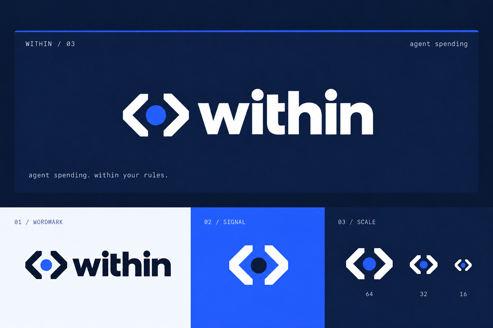

# Within brand identity

**Within**

**Agent spending. Within your rules.**

A policy wallet for AI agents on XRPL.

## Name and message

Use **Within** as the brand name in prose, browser titles, and deck covers. Use lowercase **within** in the logo. The canonical tagline is **Agent spending. Within your rules.** The lowercase form on the terminal board is a visual treatment of the same line.

**Agent spending. Within your rules.** is the subtitle beside the name. Policy Wallet and Lending Desk remain component descriptions used to identify the existing demo and evidence.

The name describes the product's central idea: an agent can spend inside an operator-defined policy. The brackets draw that boundary; the cobalt point represents the agent operating inside it. The terminal treatment gives the identity a developer character, while disciplined spacing and restrained typography keep it credible for finance.

## Copy to use

| Placement | Copy |
|---|---|
| Project name | Within |
| Tagline | Agent spending. Within your rules. |
| Descriptor | A policy wallet for AI agents on XRPL. |
| Supporting line | Policy before the wallet signs. |
| Demo link | View the demo |
| Evidence link | Verify the receipt |

For a spoken introduction:

> Within gives AI agents a wallet URL for policy-controlled payments on XRPL. The wallet checks requests before signing. Eligible payments auto-sign; eligible larger payments wait for approval in the Ledger Speculos emulator.

The paying wallet client does not receive the signing key. The separate lending borrower does hold its own key. Recorded emulator taps were scripted; the recordings do not prove human review. The tagline describes the wallet's policy behavior, not a claim that all authority is enforced on-chain.

## Visual identity

| Color | Value | Role |
|---|---|---|
| Ink navy | `#0A1630` | Main dark ground and text on pale |
| Shell navy | `#101E42` | Inset terminal surface |
| Cobalt | `#2F5BFF` | Agent dot, top rule, action emphasis, color fields |
| Pale | `#F2F5FC` | Light surfaces |
| White | `#FFFFFF` | Text and reversed marks |
| Muted | `#9198A1` | Secondary text on navy |
| Light blue | `#9BB5FF` | Small links and focus indicators on navy |

Cobalt is integral to the identity. Use it as the center point in the primary logo and as a substantial color field when space allows. On cobalt, the approved inverse treatment uses white brackets and a navy dot. In UI, preserve separate labels and established colors for approved, held, and refused states.

Use **Inter** for headings and body copy and **IBM Plex Mono** for terminal labels, the status-line tagline, amounts, and hashes. These match the existing UI font stacks; system fallbacks are included in the tokens. Keep the wordmark artwork intact rather than recreating it by typing in a similar font.

Depth comes from the two navy surfaces, spacing, and a fine cobalt rule. Keep the logo flat. Avoid drop shadows, neon glow, scanlines, decorative commands, and extra terminal-window controls.

## Logo use

Allow at least one center-dot diameter of clear space around the complete logo. Preserve its proportions and central circle. Use the navy-and-cobalt transparent PNG on a light background; the black export is the monochrome alternative. The white logo on navy is shown in the board, which is presentation artwork rather than a transparent dark-mode export.

At small sizes, use a high-contrast monochrome mark and inspect it at the actual display size. The board's 16 px navy specimen is not a validated favicon.

## Voice

Write like a careful engineer explaining a useful product: specific, calm, and direct. Say what the wallet checks and what the operator approves. Keep the words **eligible**, **held**, and **refused** precise.

Use “eligible larger payments wait for approval,” not “all large payments are approved.” Use “Ledger Speculos emulator” for the demonstrated device path. Keep the lending receipt, the patched XRP app, and the wallet's spending flow distinct when describing evidence.

## Assets and adoption

- [Terminal identity board](within-logo-v3-terminal.png)
- [Navy and cobalt logo on transparent background](within-logo-v3-cobalt-transparent.png)
- [Black logo on transparent background](within-logo-v3-black-transparent.png)
- [Canonical strings and design values](brand.json)
- [Scoped CSS tokens](brand-tokens.css)

The current logo deliverables are PNGs. The original lime/cream concept and all v2 assets are superseded; use the v3 assets linked here for exports. The brand tokens are provided for owner-controlled adoption and are not imported into any running application by this package.
